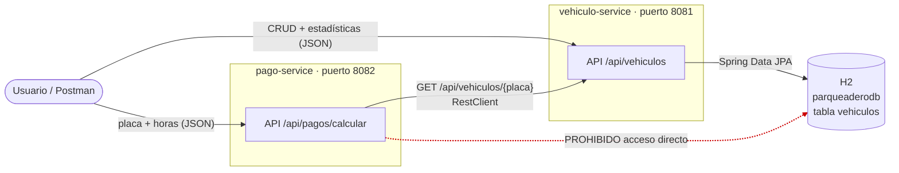
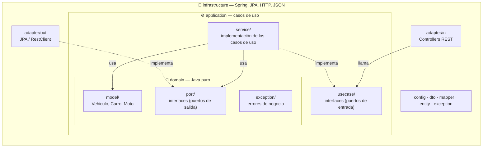
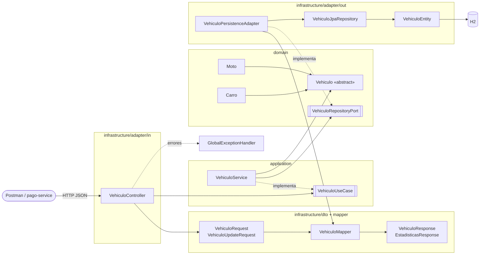
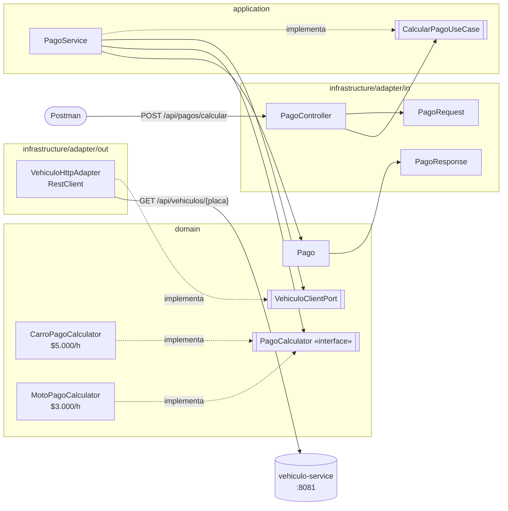
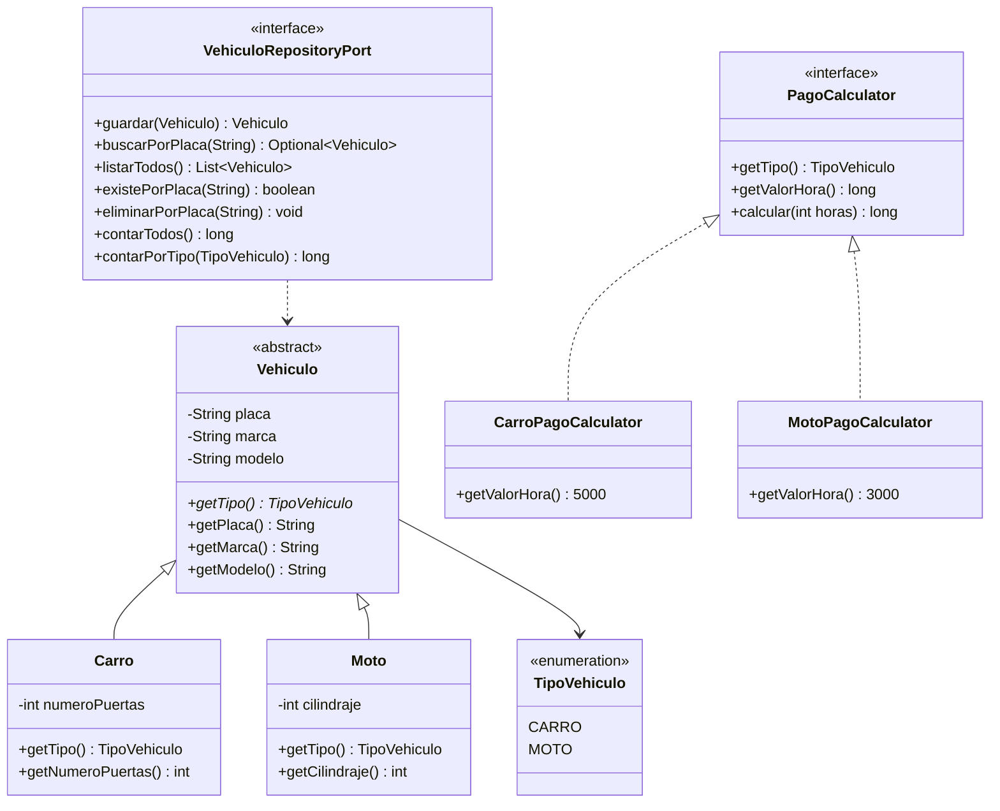
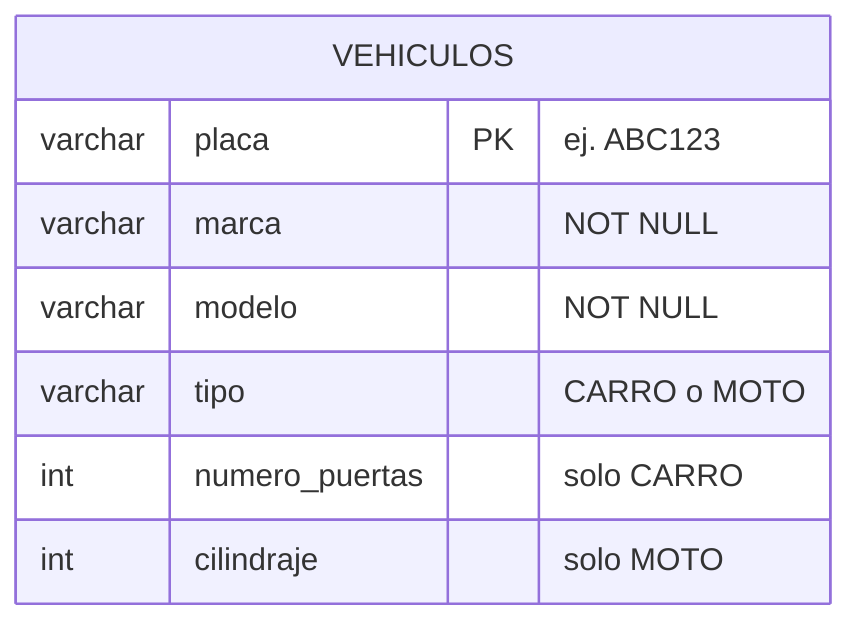

# 1. Arquitectura del sistema de parqueadero

> Arquitectura elegida: **hexagonal (puertos y adaptadores)** en los dos microservicios.
> Los diagramas están en Mermaid. GitHub los muestra directamente. En VS Code hay que instalar la extensión
> *Markdown Preview Mermaid Support* y abrir la vista previa con `Ctrl+Shift+V`.

---

## 1.1 Vista general (contexto)

Hay dos microservicios **independientes**. Cada uno tiene su propio puerto y su propio proceso.
`pago-service` **nunca** lee la base de datos de vehículos: los consulta por HTTP.

| Servicio | Responsabilidad | Persistencia | Puerto |
|---|---|---|---|
| `vehiculo-service` | Alta, consulta, actualización, eliminación y estadísticas de vehículos | H2 con Spring Data JPA | 8081 |
| `pago-service` | Recibir placa y horas, consultar el vehículo por HTTP, aplicar la tarifa | Ninguna (el historial es opcional) | 8082 |

---

## 1.2 Arquitectura hexagonal: las capas

La regla de oro es que **las dependencias siempre apuntan hacia adentro**. El dominio no conoce
Spring, JPA ni HTTP. La infraestructura sí conoce al dominio.

| Capa | ¿Qué contiene? | ¿De qué puede depender? |
|---|---|---|
| **domain** | Entidades de negocio, reglas, puertos de salida y excepciones | De nada externo (solo Java) |
| **application** | Casos de uso: orquesta el dominio | Solo del dominio |
| **infrastructure** | Controladores, JPA, cliente HTTP, DTOs, mappers, configuración | Del dominio, de la aplicación y de Spring |

---

## 1.3 vehiculo-service: componentes

---

## 1.4 pago-service: componentes

**Polimorfismo:** `PagoService` no tiene ningún `if (tipo == CARRO)`. Busca en un `Map<TipoVehiculo, PagoCalculator>`
la calculadora que corresponde y llama a `calcular(horas)`. Para agregar un **Camión** basta con crear
`CamionPagoCalculator`; `Carro` y `Moto` no se tocan (principio abierto/cerrado).

---

## 1.5 Modelo de clases (POO)

---

## 1.6 Modelo de datos (vehiculo-service)

Se usa **una sola tabla**: la columna `tipo` distingue carros de motos y los campos propios de cada
tipo admiten `NULL`.

---

## 1.7 ¿Por qué hexagonal y no MVC? (para la sustentación)

| Aspecto | MVC por capas | Hexagonal |
|---|---|---|
| Dependencia del dominio | El modelo suele ser la entidad JPA | El dominio es Java puro y la entidad JPA es aparte |
| Cambiar H2 por MySQL | Se toca el modelo | Solo cambia el adaptador `out` |
| Cambiar REST por otra entrada | Se toca el controlador y el servicio | Se agrega otro adaptador `in` |
| Pruebas unitarias | Hay que simular JPA | Se simula una interfaz (puerto) con Mockito |
| Complejidad | Menor | Algo mayor (más clases) |

**Justificación:** el enunciado la recomienda y separa con claridad las reglas de negocio (tarifas,
validaciones, duplicados) de la tecnología. Además, el bonus del **Camión** sale casi gratis gracias a los
puertos y al patrón *Strategy* de las calculadoras.
