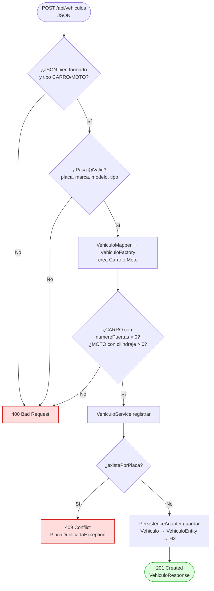
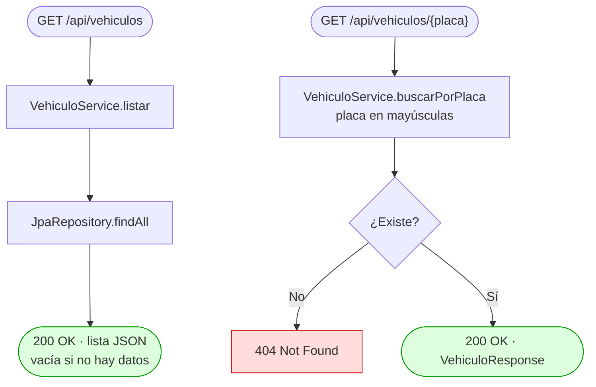
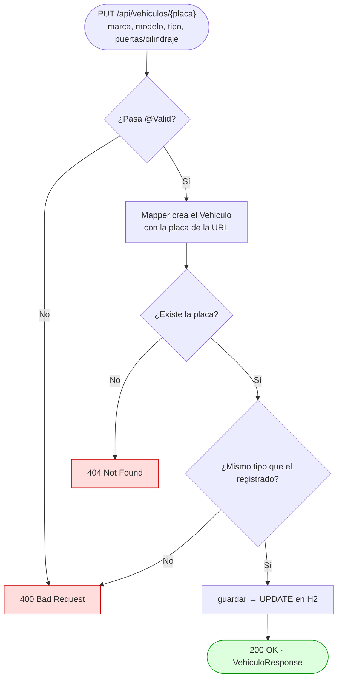
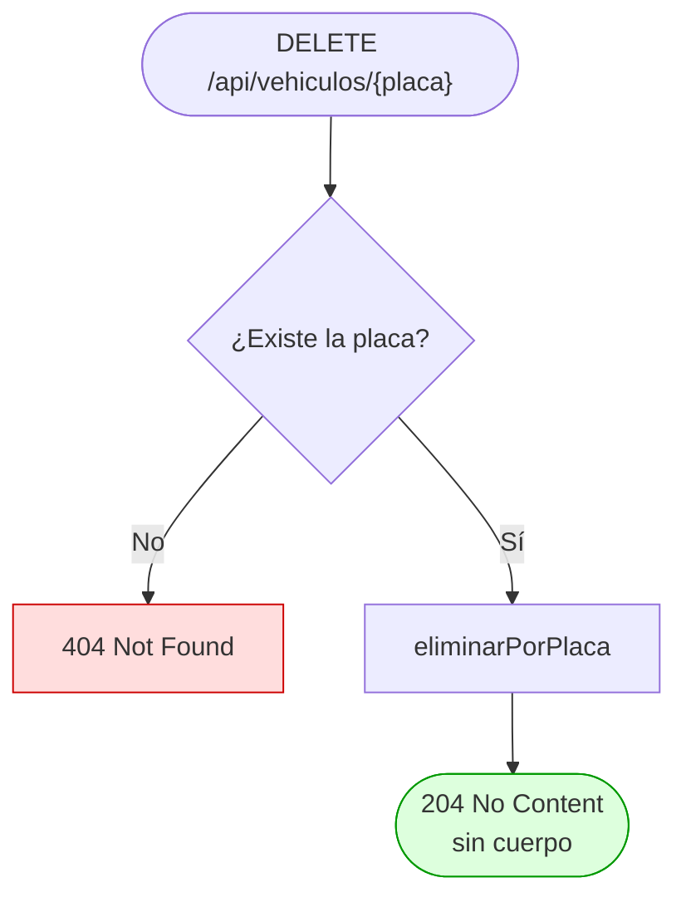
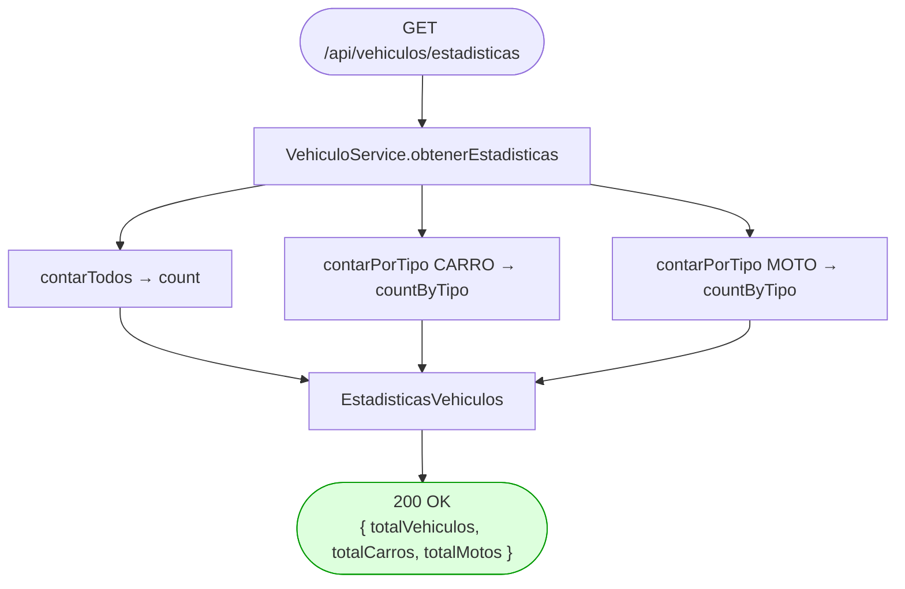
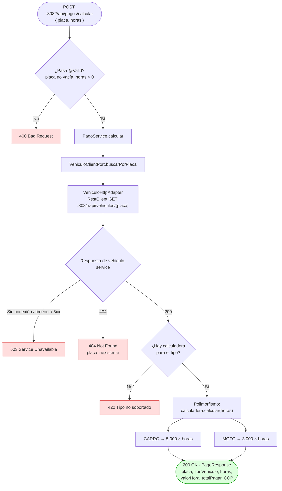
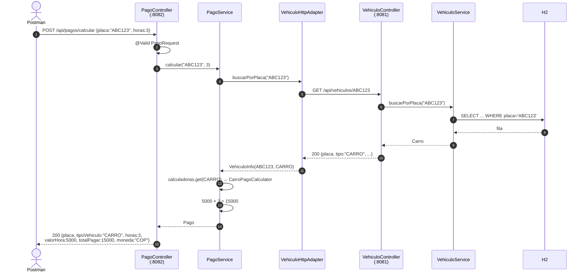
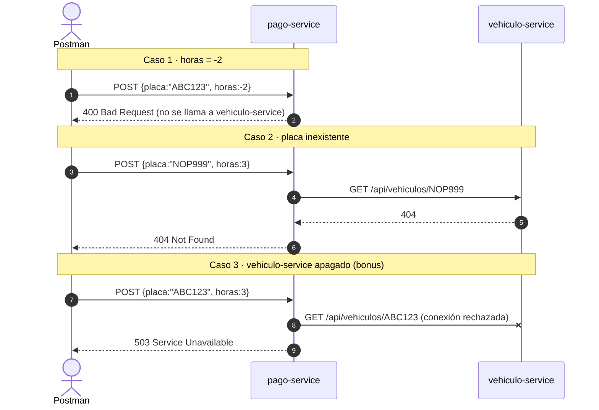

# 2. Diagramas de flujo

Cada diagrama sigue una petición desde que llega hasta la respuesta HTTP. Las cajas rojas son errores
que atiende el `GlobalExceptionHandler`.

---

## 2.1 RF-01 · Registrar vehículo (`POST /api/vehiculos`)

---

## 2.2 RF-02 / RF-03 · Listar y buscar por placa

---

## 2.3 RF-04 · Actualizar (`PUT /api/vehiculos/{placa}`)

La placa **sale de la URL** y no se puede cambiar. Tampoco se permite convertir un carro en moto.

---

## 2.4 RF-05 · Eliminar (`DELETE /api/vehiculos/{placa}`)

---

## 2.5 RF-07 · Estadísticas (`GET /api/vehiculos/estadisticas`)

> Spring da prioridad a las rutas literales sobre las variables, así que `/estadisticas` **no** se
> confunde con `/{placa}`.

---

## 2.6 RF-06 · Calcular pago (`POST /api/pagos/calcular`): flujo principal

Es el flujo más importante porque muestra la **comunicación entre microservicios**.

---

## 2.7 Diagrama de secuencia: cálculo de pago exitoso

## 2.8 Diagrama de secuencia: errores en el cálculo

---

## 2.9 Tabla resumen de códigos HTTP

| Situación | Excepción | Código |
|---|---|---|
| Registro exitoso | — | 201 |
| Consulta / actualización / cálculo exitoso | — | 200 |
| Eliminación exitosa | — | 204 |
| JSON inválido, `@Valid` falla, horas ≤ 0, datos del tipo inválidos | `MethodArgumentNotValidException`, `ReglaNegocioException`, `HorasInvalidasException` | 400 |
| Placa no existe | `VehiculoNoEncontradoException` | 404 |
| Placa duplicada | `PlacaDuplicadaException` | 409 |
| Tipo sin calculadora | `TipoNoSoportadoException` | 422 |
| vehiculo-service caído | `ServicioNoDisponibleException` | 503 |
